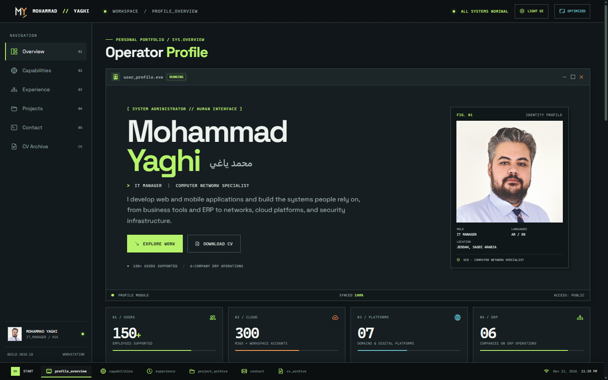

# Mohammad Yaghi | Portfolio

An OS-themed personal portfolio showcasing my experience, projects, and skills.

Built with PHP, JavaScript, HTML, and CSS.



## Get Started

```bash
git clone https://github.com/moeyaghi/MY-Portfolio.git
cd MY-Portfolio
php -S 127.0.0.1:8099 dev-router.php
```

Open `http://127.0.0.1:8099/`, or use `curl http://127.0.0.1:8099/` for the terminal view.

Edit `index.php` for portfolio content, `includes/cv_template.php` for the CV, and `includes/terminal_portfolio.php` for the curl view. Styles and images are in `assets/`. For configuration, use `includes/config.example.php` as a starting point for `includes/config.local.php`.